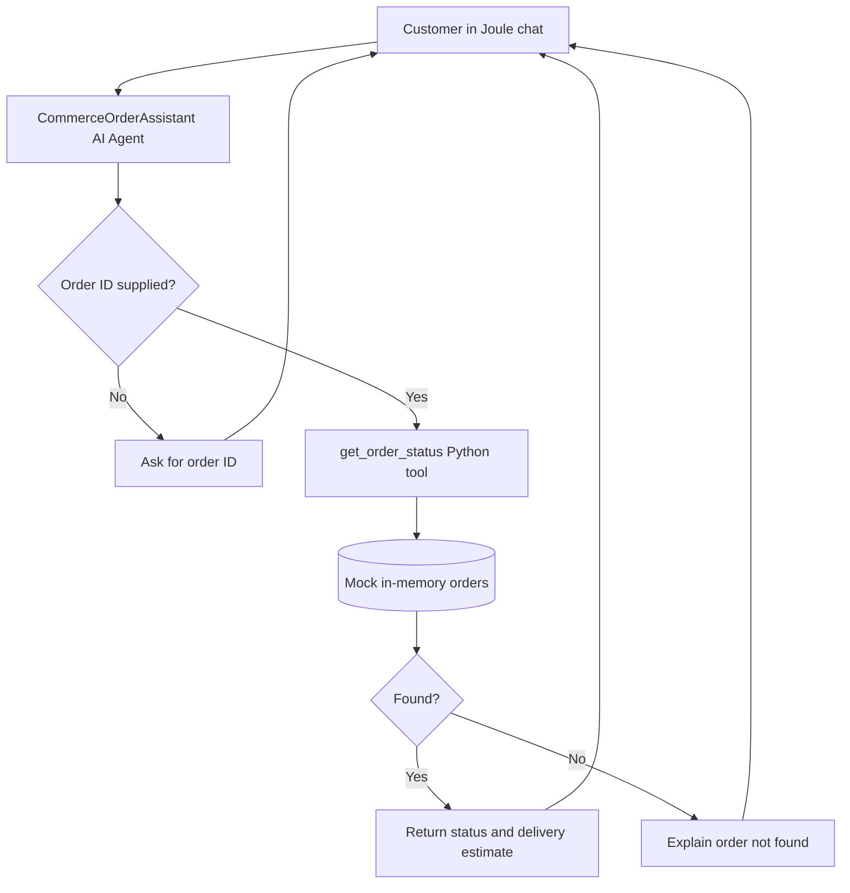

# CommerceOrderAssistant

**An AI-powered e-commerce order tracking agent built as a SAP Joule Studio practice project.**

CommerceOrderAssistant helps shoppers ask natural-language questions about an order and receive its status and estimated delivery date. It uses a **read-only mock order lookup tool** instead of connecting to production customer or order systems.

> **Project status (November 19, 2026):** Agent implementation and offline tests completed. The SAP learning-tenant deployment currently shows **Degraded / In Progress**, and live deployment is **not verified**. The examples and order data are simulated. This is a hands-on learning project, not evidence of SAP certification completion or production readiness.

## What problem does it solve?

Customers often contact support simply to ask where their order is. An order-status assistant can automate basic tracking inquiries, surface the same information consistently, and refer unsupported requests to a human support channel.

**Example conversation**

```text
Customer: Where is my order ORD-0003?
Agent: Order ORD-0003 (Portable Laptop Stand) is Shipped.
       Estimated delivery: November 22, 2026.

Customer: Can you track my order?
Agent: Please provide your order ID (for example, ORD-0003).

Customer: Where is my order ORD-9999?
Agent: I couldn't find that order. Please check the order ID.
```

These example responses are based on the practice dataset, not live fulfilment data.

## Key capabilities

- Understands natural-language order tracking requests.
- Requests an order ID when it is missing.
- Looks up order status through a Python tool, `get_order_status()`.
- Returns product, current status, and estimated delivery when available.
- Recognizes case-insensitive IDs (for example, `ord-0003`).
- Handles unknown orders and cancelled orders without fabricating delivery dates.
- Keeps order lookup read-only; no cancellations, refunds, order changes, or customer PII are processed.
- Includes agent instructions, tests, and OpenTelemetry instrumentation.

## Architecture



**Technology:** SAP Joule Studio; Python; LangChain/LangGraph-based tool integration; A2A agent service; mock in-memory data; OpenTelemetry; Python automated tests.

## Mock data examples

| Order ID | Product | Status | Estimated delivery |
|---|---|---|---|
| `ORD-0001` | Wireless Bluetooth Headphones | Delivered | 2026-11-10 |
| `ORD-0002` | Running Shoes (Size 10) | Out for Delivery | 2026-11-19 |
| `ORD-0003` | Portable Laptop Stand | Shipped | 2026-11-22 |
| `ORD-0004` | Mechanical Keyboard | Processing | 2026-11-25 |
| `ORD-0005` | Ergonomic Office Chair | Shipped | 2026-11-21 |
| `ORD-0006` | Smart Watch | Cancelled | N/A |

The generated practice dataset contained 12 orders. Only six examples are shown above.

## Project structure

The SAP-generated project reported the following files. Paths may differ in the exported repository:

```text
solution.yaml
assets/
  commerce-order-assistant-agent/
    asset.yaml
app/
  agent.py                 # agent instructions and tool wiring
  order_lookup_tool.py     # in-memory mock order lookup
  main.py                  # A2A service entry point
tests/
  test_order_lookup_tool.py
  test_agent_server.py
  test_integration.py
```

> This README documents the project. **The Python implementation is not included in this README alone.** Export the source from Joule Studio separately before describing this repository as runnable.

## Testing and evaluation

Results reported by the SAP Joule Studio practice environment:

| Check | Reported result |
|---|---:|
| Automated tests | 150 passed, 0 failed |
| Code coverage | 75.44% |
| Offline evaluation scenarios | 7 scenarios |
| Offline evaluation checks | 45/45 passed |
| Tool lookup checks | 16/16 passed |

Test scenarios included known orders, unknown orders, missing IDs, cancelled orders, case-insensitive IDs, grounded answers, out-of-scope requests, and follow-up conversation handling.

**Scope of verification:** The evaluation report indicated that a mocked language model/test harness was used because AI Core was unavailable in the learning sandbox. The above numbers **do not establish healthy live deployment, real-LLM accuracy, or production performance**.

## Setup and usage

1. Create or open a SAP Joule Studio development solution.
2. Create an AI Agent named `CommerceOrderAssistant`.
3. Supply the business intent and requirements for read-only order tracking against mock data.
4. Generate the agent specification and implementation.
5. Open **Testing → Preview with Mock Data** and use the example prompts below.
6. Review automated test results and trace/tool evidence.
7. Deploy only to an authorized environment with correct runtime access and model provisioning.

**Sample test prompts**

```text
Where is my order ORD-0003?
Can you track my order?
What is the status of ORD-0006?
Where is my order ORD-9999?
Track order ord-0003
```

### Running exported source locally

Runtime dependencies, startup commands, and environment variables must be verified against the actual exported SAP-generated files (`asset.yaml`, `main.py`, project dependency manifests). No unverified `pip install` or `python` startup command is provided here.

## Current limitations and next steps

- **Deployment:** SAP tenant showed a Degraded solution and an In Progress deployment job. The live agent runtime was not confirmed operational.
- **Tenant access:** SAP's interface said agent access requires configuration through the managed SAP Cloud Identity Services tenant; the tenant lookup returned HTTP 500 for the learning user.
- **Model routing:** Deployment logs showed an empty inference route bundle at one point, but this was not confirmed as the cause of degradation.
- **Data:** Orders are entirely mocked; no SAP Commerce Cloud, OMS, payment, or shipping-provider integration is implemented.
- **Security:** A real deployment would require authenticated access, authorization to specific orders, secret management, and data privacy controls.
- **Observability:** Validate live readiness, traces, latency, and error rates when a supported runtime is available.

## Roadmap

- [x] Define business intent and requirements
- [x] Generate Python mock lookup agent
- [x] Validate mock order lookup and edge cases
- [x] Complete offline automated tests and evaluation
- [ ] Resolve learning-tenant deployment health/access issues
- [ ] Verify a live invocation and tool trace
- [ ] Improve test coverage and add repeatable local setup instructions
- [ ] Optionally integrate with an authorized order-management API and real authentication

## Publishing and security notes

Before pushing an SAP-generated export to a public GitHub repository, **review its terms and your rights to publish generated code**. Do not commit credentials, API keys, SAP tenant tokens, `.env` files, internal service URLs, customer data, logs containing identifiers, or tenant-specific configuration. If the SAP Git integration requires OAuth authorization, grant only the repository scope needed.

## Learning outcomes

This exercise demonstrates requirements-to-agent development, agent tool integration, grounded responses, validation of edge cases, offline testing, telemetry, and troubleshooting of deployment/runtime access in a managed SAP environment.

---

*Educational portfolio project. Not affiliated with or endorsed by SAP. SAP and Joule are trademarks of their respective owners.*
