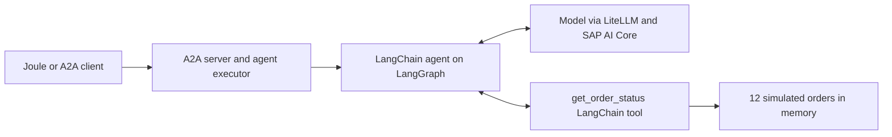

# CommerceOrderAssistant

A Python A2A agent built in SAP Joule Studio for simulated e-commerce order tracking. It uses a LangChain tool backed by 12 fictional orders to answer questions about status and estimated delivery.

The SAP Learning deployment was reported as **Degraded**. The live agent was unverified. This is an educational portfolio project with simulated data and no real customer integration, production deployment, or SAP certification claim.

## Architecture



The agent instructions ask for an order ID when it is missing and ground order details in the tool result. The read-only lookup handles case and surrounding whitespace and distinguishes unknown orders from cancelled orders. The A2A service supports streaming and uses an in-memory task store. The SAP manifests define the A2A asset and health probes.

## Run the offline lookup tests

From the repository root, change to the agent directory. These tests use the Python standard library and require no credentials.

```shell
cd assets/commerce-order-assistant-agent
python -m unittest -v tests.test_order_lookup
```

## Set up the full agent

Use Python 3.13 for the export's pinned runtime dependencies. Run these commands from the agent directory in PowerShell.

```powershell
python -m venv .venv
.\.venv\Scripts\python.exe -m pip install -r requirements.txt -r requirements-test.txt
.\.venv\Scripts\python.exe -m pytest -q
```

On macOS or Linux, use `.venv/bin/python` in place of `.\.venv\Scripts\python.exe`. The exported integration and evaluation tests use mocks. The runtime dependencies are still required to import the full agent and server.

To invoke the service with model inference, provision authorized SAP AI Core access and a deployment compatible with the model defaults or overrides in [the agent configuration](assets/commerce-order-assistant-agent/app/agent.py). Supply `AICORE_CLIENT_ID`, `AICORE_CLIENT_SECRET`, `AICORE_AUTH_URL`, and `AICORE_BASE_URL` through the local environment. Set `IBD_TESTING=1` to use the mock Agent Gateway tool path. Model inference still requires AI Core access.

```powershell
$env:IBD_TESTING = "1"
.\.venv\Scripts\python.exe app/main.py --host 127.0.0.1 --port 5000
```

In a second terminal, request the agent card and send a JSON-RPC message.

```powershell
Invoke-RestMethod http://127.0.0.1:5000/.well-known/agent.json

$body = @{
    jsonrpc = "2.0"
    id = "demo-1"
    method = "message/send"
    params = @{
        message = @{
            kind = "message"
            role = "user"
            messageId = [guid]::NewGuid().ToString()
            parts = @(@{kind = "text"; text = "Where is order ORD-0003?"})
        }
    }
} | ConvertTo-Json -Depth 8

Invoke-RestMethod -Method Post -Uri http://127.0.0.1:5000/ -ContentType "application/json" -Body $body
```

## Demo conversations

Illustrative responses based on the mock dataset and agent instructions.

```text
Shopper: Can you track my order?
Assistant: Please provide your order ID.
Shopper: ord-0003
Assistant: Order ORD-0003, a Portable Laptop Stand, has shipped.
           Estimated delivery is November 22, 2026.

Shopper: What's the status of ORD-0006?
Assistant: Order ORD-0006 was cancelled.

Shopper: Where is ORD-9999?
Assistant: I couldn't find that order. Please check the order ID.
```

## Test evidence

| Environment | Check | Result |
| --- | --- | --- |
| Local Windows, Python 3.14.6 | Standard-library lookup tests | 4 passed |
| Local Windows, Python 3.14.6 | Python source compilation | Passed |
| Local Windows | Full pytest suite | Unverified. The exported LiteLLM pin requires Python below 3.14. Windows Application Control blocked the isolated Python 3.13 interpreter. |
| SAP Learning sandbox | Automated tests | 150/150 reported by the sandbox |
| SAP Learning sandbox | Offline evaluation | 45/45 checks reported by the sandbox across seven scenarios |

The sandbox evaluation used mocked model responses. Its results were not reproduced locally and do not measure live model accuracy. The retained [evaluation definitions](assets/commerce-order-assistant-agent/aeval/) cover known, missing, cancelled, and unknown orders, grounding, scope boundaries, and follow-up context.

## Limitations

- The dataset is static and contains no customer records or live delivery estimates.
- The assistant redirects requests for refunds, returns, cancellations, and order edits to support.
- The A2A server is intended for local practice or a managed SAP runtime. Its bearer-token middleware passes request context to the SDK. Production use would need verified authentication and per-order authorization.
- End-to-end AI Core inference, deployment readiness, and live telemetry were unverified.
